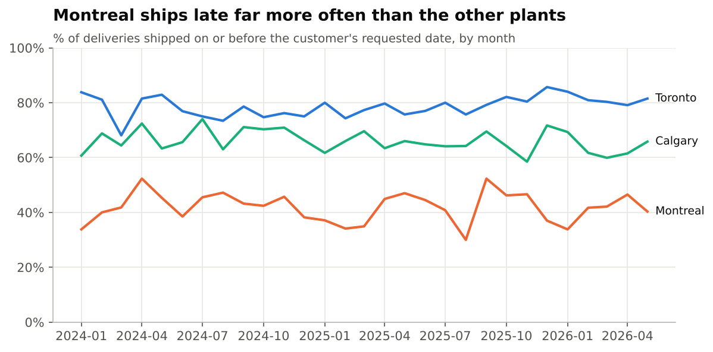
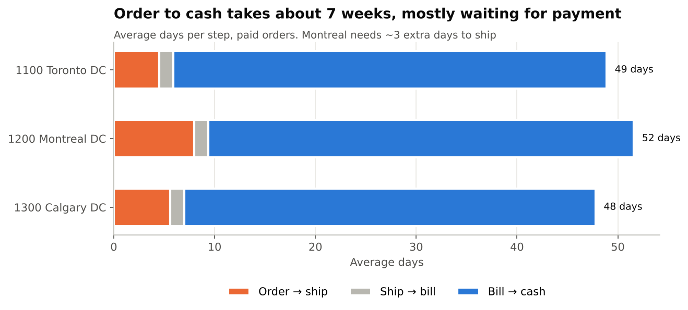
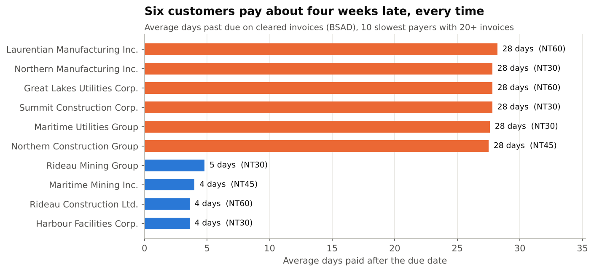
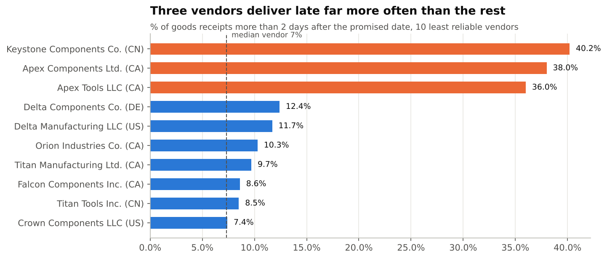
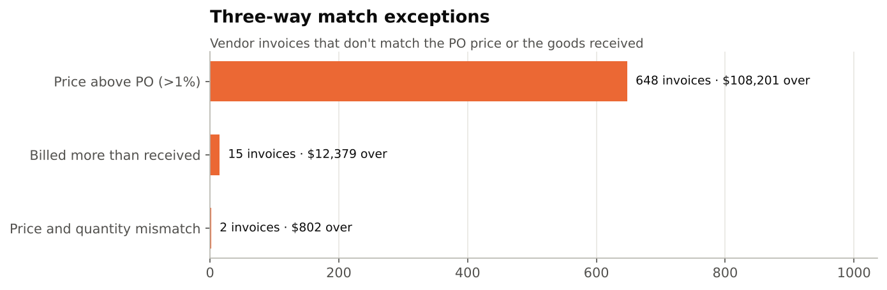

# SAP ERP Analytics: Order-to-Cash and Procure-to-Pay

SQL analysis of the two core SAP S/4HANA business processes, built on the **real SAP table and field names**
(`VBAK`, `LIKP`, `VBRK`, `BSAD`, `EKKO`, `EKPO`, `MSEG`, `RBKP` ...) for a fictional Canadian distributor,
*Maple Industrial Supply Inc.* (company code 1000, CAD, plants in Toronto, Montreal and Calgary).



> **About the data.** Companies never publish their SAP data, so [generate_data.py](generate_data.py) simulates a
> 2.5-year ERP extract (Jan 2024 – Jun 2026): 11,659 sales orders, 12,938 purchase order items and the full
> document chain behind them, in 25 SAP tables. The simulation includes realistic operational problems
> (slow plant, late payers, unreliable vendors, price creep, after-the-fact POs). The analysis finds them from
> the tables alone, the way an analyst would with a real extract from SE16N or a BW/Datasphere export.
> The seed is fixed, so every number below is reproducible.

## Order-to-Cash (SD + FI-AR)

```
VBAK/VBAP  ──>  LIKP/LIPS  ──>  VBRK/VBRP  ──>  BSID (open)  ──>  BSAD (cleared)
sales order     delivery &      billing         customer          customer item
                goods issue     document        open item         paid & cleared
```

| Question | Query | Finding |
|---|---|---|
| Does the document flow close? | [01](sql/o2c/01_document_flow.sql) | 11,659 orders → 286 rejected → 11,291 delivered → 11,267 billed → 10,498 paid by the extract date. |
| Is revenue growing? | [02](sql/o2c/02_monthly_revenue.sql) | H1 2026 net revenue is **+30%** vs. H1 2025 (CAD 11.7M vs. 9.0M). |
| How long is the cash cycle? | [03](sql/o2c/03_cycle_time_by_plant.sql) | **49 days** from order to cash on average; 42 of them are waiting for the customer to pay. |
| Do we ship on time? | [04](sql/o2c/04_on_time_delivery.sql), [05](sql/o2c/05_on_time_by_month.sql) | Toronto ships 78% of orders by the requested date, Calgary 66%, **Montreal only 43%**, and 13% of Montreal orders ship more than a week late. It is a steady gap across all 30 months, not a one-off. |
| Who pays late? | [06](sql/o2c/06_customer_payment_behaviour.sql) | **Six customers pay ~28 days after the due date**, on 82–94% of their invoices. They are 5.6% of revenue but **25% of overdue receivables**. |
| How old are open receivables? | [07](sql/o2c/07_ar_aging.sql) | 88% of open AR is not yet due; 11% is 1–30 days overdue. |
| DSO trend | [08](sql/o2c/08_dso_by_quarter.sql) | Days Sales Outstanding moves between 35 and 49 days, lowest at each December quarter-end. |
| Customer concentration | [09](sql/o2c/09_customer_abc.sql) | ABC analysis: 23 customers (38%) bring in 79% of revenue. |




## Procure-to-Pay (MM + FI-AP)

```
EBAN  ──>  EKKO/EKPO/EKET  ──>  MSEG (101)  ──>  RBKP/RSEG  ──>  BSAK
requisition   purchase order     goods receipt    vendor invoice   vendor paid
```

| Question | Query | Finding |
|---|---|---|
| How fast are requisitions turned into POs? | [01](sql/p2p/01_pr_to_po_cycle.sql) | Purchasing groups 001 and 002 take 2–3.5 days. **Group 003 takes 9 days**, and 82% of its requisitions wait more than 5 days. |
| Which vendors deliver late? | [02](sql/p2p/02_vendor_on_time.sql) | The median vendor is late on 7% of receipts. **Three vendors are late 36–40% of the time**, by 8–9 days when they are late. |
| Do invoices match the PO and the goods receipt? | [03](sql/p2p/03_three_way_match.sql) | 94.8% pass the three-way match. 648 invoices are priced >1% above the PO (CAD 108k overbilled); 15 bill more units than were received. |
| Who causes the price mismatches? | [04](sql/p2p/04_price_variance_by_vendor.sql) | **One vendor (Falcon Components) went from 2% to 61% of invoices above PO price after Jan 2025**: CAD 50k overbilled. A vendor price increase that never reached the PO conditions. |
| Are POs raised after the fact? | [05](sql/p2p/05_maverick_buying.sql) | **5.1% of PO value** had a vendor invoice dated before the PO existed ("maverick buying"); 15% of PO items have no requisition. |
| Spend concentration | [06](sql/p2p/06_spend_by_vendor.sql) | The top vendor is 56% of spend; the top 4 are 81%. A high supply risk if the top vendor fails. |




## Recommendations

1. **Montreal DC:** review picking capacity and stock levels. Montreal ships ~1,200 orders a year; reaching
   Calgary's 66% on-time rate would put ~280 more of them on time.
2. **Collections:** put the six chronic late payers on credit review (credit limit in FD32 / UKM) or move them to
   shorter terms. They hold a quarter of overdue AR.
3. **Falcon Components:** update the purchasing info record / PO price conditions, or reject invoices outside
   tolerance (set the invoice verification tolerance keys in OMR6).
4. **Purchasing group 003:** find out why requisitions wait 9 days (approval workflow, workload).
5. **Vendor scorecard:** use query p2p/02 as a monthly scorecard; set targets for the three late vendors or
   qualify second sources for their materials.

## SQL techniques used

Multi-table joins along SAP document flow (`VGBEL`/`VGPOS`, `AUBEL`, `EBELN`/`EBELP`) · CTEs · window functions
(`SUM() OVER (ORDER BY …)` for Pareto/ABC, `ROW_NUMBER`) · `QUANTILE_CONT` · `GROUP BY ROLLUP` ·
date arithmetic for due dates (`ZFBDT + ZBD1T`), aging buckets and a point-in-time DSO with
`generate_series` + `CROSS JOIN`.

## How to run

```bash
pip install -r requirements.txt
python generate_data.py   # optional: data/ is already in the repo
python analysis.py        # loads data/*.csv into sap.duckdb, runs sql/o2c and sql/p2p, writes results/ and charts/
```

You can also open `sap.duckdb` in DBeaver or the DuckDB CLI and query the SAP tables directly.

## SAP tables included

| Area | Tables |
|---|---|
| Master data | `KNA1`/`KNB1` customers, `LFA1`/`LFB1` vendors, `MARA`/`MAKT`/`MBEW` materials, `EINA` info records, `T001W` plants |
| Sales (SD) | `VBAK`/`VBAP` orders, `LIKP`/`LIPS` deliveries, `VBRK`/`VBRP` billing |
| Receivables (FI-AR) | `BSID` open items, `BSAD` cleared items |
| Purchasing (MM) | `EBAN` requisitions, `EKKO`/`EKPO`/`EKET` purchase orders |
| Inventory (MM-IM) | `MSEG` goods movements (101 = goods receipt) |
| Invoice verification / AP | `RBKP`/`RSEG` vendor invoices, `BSAK` cleared vendor items |

The tables keep only the fields needed for the analysis, and some links are simplified (for example, the
billing document number is stored on the FI item instead of going through `BKPF`).

**Tools:** SQL · DuckDB · Python · pandas · matplotlib · SAP SD / MM / FI data model
